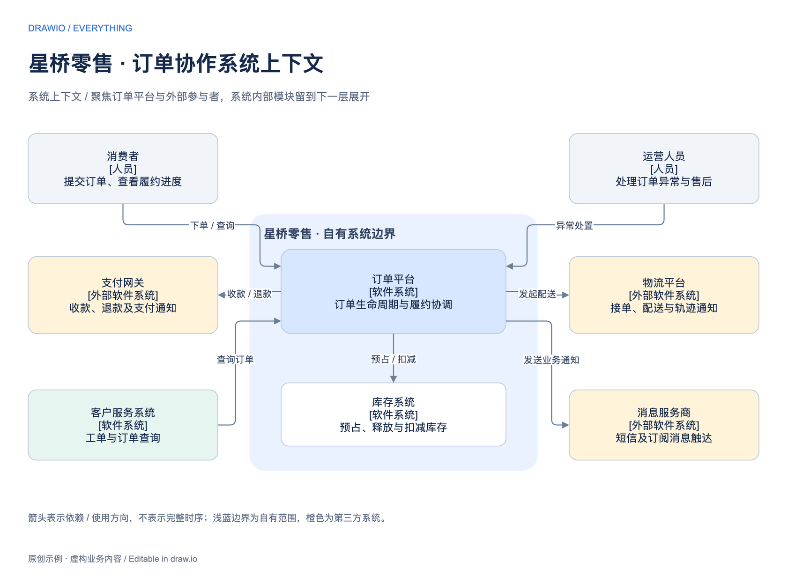
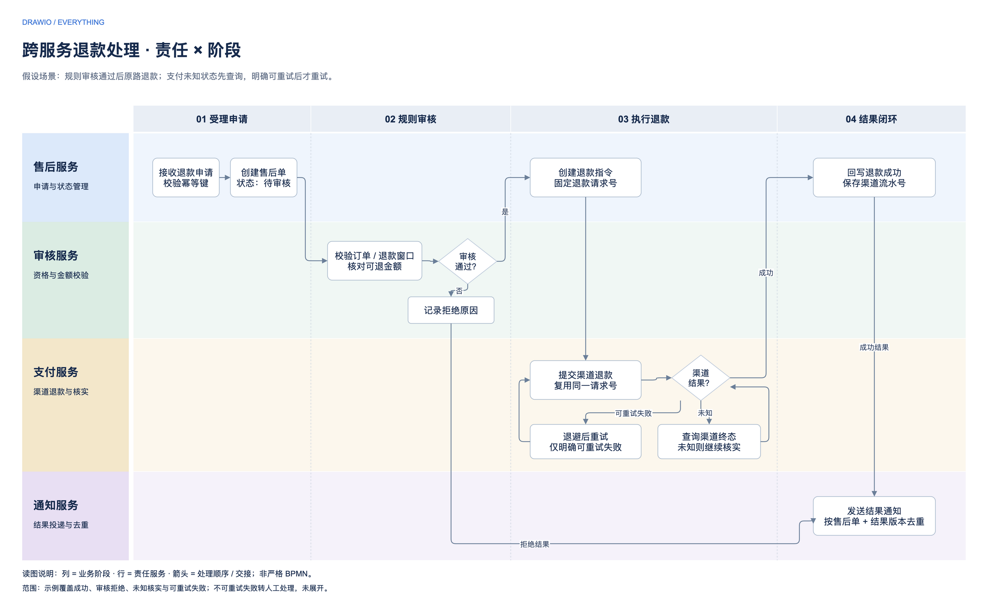
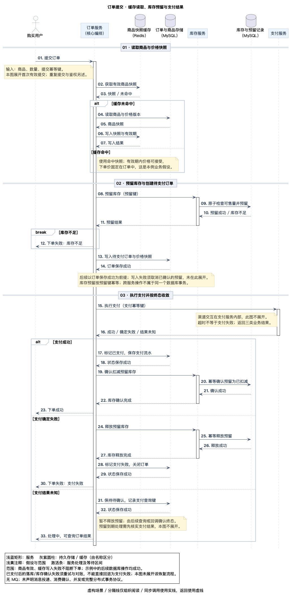
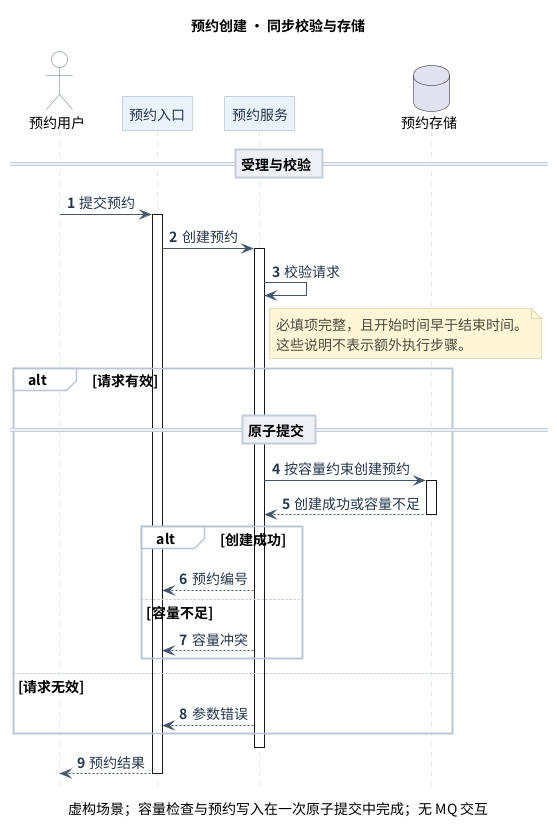

<div align="center">

# draw-io-everything

**从场景出发，让关系清楚，让图更好读。**

面向各类工程场景的图构建 skill · 场景选型 · 专业表达 · 多种构图 · 持续学习

[场景与图种](#从场景选择表达方式) · [输出方式](#选择合适的输出方式) · [快速开始](#快速开始) · [示例画廊](#示例画廊) · [如何学习你的风格](#如何学习你的风格) · [能力边界](#能力边界)

</div>

`draw-io-everything` 专注于把业务与技术场景转化为表达准确、可读、美观的工程图：理解读者的问题，选择图种与视角，组织对象和关系，再用构图、色彩与细节建立清晰的阅读路径。

项目名称沿用 `draw-io-everything`，定位不限定于 draw.io 文件形式。图种、设计方法与输出工具分别选择；当前已提供 draw.io 工程图和 PlantUML 时序图的实际工作流与示例。

它的核心是持续学习：你提供照片、截图、原生文件或总结，skill 分别记录**风格、结构模板、局部模式**，再根据新内容选择和适配。每次学习都有来源和适用边界；个人偏好与技术验证分别记录。

## 从场景选择表达方式

| 读者需要理解什么 | 可选择的图示 | 表达重点 |
| --- | --- | --- |
| 工作如何推进、在哪交接 | 流程图、责任泳道、BPMN 协作图 | 步骤、责任、条件与异常出口 |
| 服务如何按顺序交互 | 时序图 | 参与者、调用与返回、条件分支 |
| 系统边界与内部组成 | 上下文、系统全景、分层架构图 | 范围、职责、依赖与抽象层级 |
| 应用和能力如何归属 | 应用资产图、业务能力地图 | 分类、层级、覆盖与状态 |
| 数据从哪里来、到哪里去 | 数据血缘、数据管道图 | 来源、转换、消费与粒度 |
| 系统如何部署和连接 | 部署、集群、网络拓扑图 | 实例、区域、节点与连接关系 |

复杂方案可以拆成过程、结构、控制与实施等配套视图，同一对象跨视图保持名称与含义一致。无需把所有问题挤进一张图，也不强求各类图使用同一种布局。

## 选择合适的输出方式

先确定图要回答的问题，再结合编辑习惯、协作方式和实际工具选择交付形式。指定工具或格式时，遵从用户要求。

| 当前已支持的方式 | 适合的需求 | 可编辑交付 | 预览 |
| --- | --- | --- | --- |
| draw.io | 需要自由布局、可视化编辑的流程、架构、资产、血缘与拓扑图 | `.drawio` | PNG；可按工具能力补充 SVG/PDF |
| PlantUML | 需要文本维护、版本比较与重复渲染的时序图 | `.puml` + 本地 `.iuml` 样式 | PNG / SVG |

学习得到的阅读层级、分组、语义配色和局部模式可以跨工具适配；具体符号、连线规则和验证方式仍服从图种及目标工具。其他输出方式可以逐步扩展，但本仓库尚未提供其经过验证的工作流。

## 我们如何判断一张图是否好

**表达目的明确 → 关系正确 → 呈现清晰 → 视觉增强。**

用简单图形表达必要关系；通过比例、对齐、间距和留白组织信息。流程与架构的一般关系优先圆角折线，时序消息遵守同步、返回和异步语义；色彩用于区分业务归属、主次或状态，不以复杂图案、装饰或节点数量衡量质量。

[基础美感准则](references/visual-design.md) · [专业表达准则](references/professional-diagrams.md)

## 一类图，多种表达方案

同一图种可以积累多种构图、配色和局部模式。先确定表达目的与关系，再按内容规模、读者和展示尺寸选择兼容组合。新图例扩充选择，不自动替代既有方案；保持一致的是语义正确与基础美感。

## 快速开始

将本仓库作为 `draw-io-everything` 技能目录放入 Codex 的 skills 目录。首次安装、目标目录不存在时：

```bash
git clone --branch master \
  https://github.com/Junglepan/drawio-everything.git \
  "${CODEX_HOME:-$HOME/.codex}/skills/draw-io-everything"
```

已有同名 skill 时，先对比版本再更新，避免覆盖本地修改。其他支持 `SKILL.md` 的助手可按其技能加载机制使用；目前未逐一验证所有客户端。

技能名由 `drawio-everything` 改为 `draw-io-everything`，GitHub 仓库地址保留不变。已有旧目录时，先保留本地修改再调整安装目录与调用名，避免同时加载两份；个人资产库仍兼容 `~/.drawio-everything/library/`，不自动迁移或覆盖记录。

生成源码需要具备文件读写能力的 AI 助手；draw.io 预览可使用 Desktop 或 diagrams.net 编辑器。原有示例重建脚本需要 Python 3；PlantUML 重建脚本需要 Python 3.11+、Java 21、fontconfig 和 Noto Sans CJK SC，首次运行获取校验后的固定版本 JAR。skill 不包含模型、draw.io 安装包或专用 MCP 服务。

**从场景开始，不必预先指定工具**

```text
使用 $draw-io-everything，帮我表达订单、库存、支付服务的协作。
读者是研发评审人员，需要看清责任交接、支付失败和结果未知的处理。
先选择适合的图种、构图和当前可用的输出方式，说明选择理由，
再交付可编辑源码与实际预览。不要为布局补造业务关系。
```

**明确图种与交付格式**

```text
使用 $draw-io-everything，为订单平台画系统上下文图。
读者是产品与研发负责人；包含客户、订单平台、支付平台、配送平台。
关系为客户下单、订单平台发起支付和提交配送任务。
交付可编辑 .drawio 与 PNG，检查文字和连线。
```

**从参考图学习**

```text
使用 $draw-io-everything，学习附件图例。
我喜欢它的分组和阅读顺序。提取可复用风格与结构模板，
记录适用场景、内容增多时的处理方法及不适合照搬的部分。
```

**生成或编辑 PlantUML 时序图**

```text
使用 $draw-io-everything，为虚构预约服务生成 PlantUML 时序图。
展示用户、入口、预约服务与存储的调用、返回和容量不足分支。
按时序图规范适配风格，交付 .puml、所需样式和实际 PNG/SVG，
说明 PlantUML 版本、JDK、字体及未验证项。
```

**明确偏好范围**

```text
这次只把异常路径改成橙色，不修改默认风格。
```

```text
以后我的应用资产图默认使用这种卡片布局，其他图种保持不变。
```

## 示例画廊

按图要回答的问题选择示例，再看适用的表达与输出方式。以下包含 draw.io 多场景画廊，以及 PlantUML 预约和跨服务订单时序图；均提供源码、预览与范围说明。

## 进阶场景：接近真实工作的图

四个独立的虚构场景展示更高的信息密度。分别采用系统边界、协作泳道、字段路径与循环控制的表达方式；不把所有图种套进同一种卡片布局。点击预览可查看大图，源文件可直接在 draw.io 编辑。

### 全渠道零售 · 系统全景

面向架构评审：人员与系统保持同一层级，组织边界区分内部能力和外部合作方；每条关系说明业务目的，节点给出类型与职责。


[可编辑源文件](examples/advanced/retail-landscape.drawio) · [完整预览](examples/advanced/retail-landscape.png)

### 跨组织退货 · 协作流程

面向流程评审：区分客户与企业参与者、企业内部岗位交接以及条件分支。采用 BPMN 表示法子集，按声明范围检查，不声称完整规范认证。


[可编辑源文件](examples/advanced/returns-collaboration.drawio) · [完整预览](examples/advanced/returns-collaboration.png)

### 收入指标 · 字段级血缘

面向数据治理：展开相关字段，说明转换与指标口径；突出选定影响路径，同时保留来源和下游消费者。静态图中不放置无法操作的筛选或翻页控件。


[可编辑源文件](examples/advanced/revenue-lineage.drawio) · [完整预览](examples/advanced/revenue-lineage.png)

### 批量对账 · 循环与异常收敛

面向实现评审：主流程之外交代重试上限、循环推进、失败处理与取消出口，避免只有成功路径的演示流程。


[可编辑源文件](examples/advanced/reconciliation-flow.drawio) · [完整预览](examples/advanced/reconciliation-flow.png)

[专业图质量准则](references/professional-diagrams.md) · [按场景选择示例](references/gallery.md)

## 场景画廊：11 类常用工程图

以下 11 张图由本项目使用虚构内容制作，提供原生节点、文字与连接器，可在 draw.io 中编辑。PNG 由 draw.io Desktop 实际导出；示例用于展示结构与表达方式，不构成生产架构方案或全面标准合规认证。

| 类型 | 适用场景 | 设计重点 |
| --- | --- | --- |
| [流程图](examples/01-flow.drawio) | 操作流程、条件分流 | 主方向、条件标签与分支汇合 |
| [泳道图](examples/02-swimlane.drawio) | 跨服务交接与补偿 | 责任分区与阶段对齐；非完整 BPMN 范例 |
| [部署架构图](examples/03-cloud.drawio) | 部署方案与技术沟通 | 网络边界、服务分区与重复实例 |
| [集群组件图](examples/04-cluster.drawio) | 组件职责与控制关系 | 控制面、工作节点与同构布局 |
| [时序图](examples/05-sequence.drawio) | 接口调用与异步通知 | 参与者列、阶段与消息方向 |
| [系统上下文图](examples/06-context.drawio) | 系统范围与外部协作 | 同一抽象层级与关系说明 |
| [应用资产图](examples/07-application.drawio) | 应用盘点与生命周期 | 位置表达归属，颜色与符号表达状态 |
| [数据血缘图](examples/08-lineage.drawio) | 字段影响分析 | 局部展开与关注路径 |
| [网络拓扑图](examples/09-network.drawio) | 设备连接与运维总览 | 区域、接入与共享骨干 |
| [业务能力图](examples/10-capability.drawio) | 能力目录与企业规划 | 层级网格与独立说明区 |
| [数据流水线图](examples/11-pipeline.drawio) | 采集、处理与消费 | 输入、处理、输出三段式 |

### 流程图

以生产发布为例，补齐自动门禁、负责人审批、灰度指标判断和回退路径。条件出口有明确去向，异常路径沿主轴两侧展开。


[可编辑源文件](examples/01-flow.drawio) · [完整预览](examples/01-flow.png)

### 泳道图

以订单确认为例，展示订单、库存、支付和通知服务的交接与补偿。只根据已确认的支付终态关闭订单；不是严格 BPMN 图。


[可编辑源文件](examples/02-swimlane.drawio) · [完整预览](examples/02-swimlane.png)

### 部署架构图

以会员商城为例，展示双可用区 API、任务 Worker、主备数据库与消息代理，区分访问与复制关系。


[可编辑源文件](examples/03-cloud.drawio) · [完整预览](examples/03-cloud.png)

### 集群组件图

以推荐服务集群为例，展开 API Server、etcd、调度与控制器，以及工作节点内的 kubelet、运行时和 Pod。控制关系与业务流量分开。


[可编辑源文件](examples/04-cluster.drawio) · [完整预览](examples/04-cluster.png)

### 时序图

以订单创建为例，展示库存预留成功/失败、订单与 Outbox 本地事务、异步投递及通知去重，区分调用、返回和事件。


[可编辑源文件](examples/05-sequence.drawio) · [完整预览](examples/05-sequence.png)

### 系统上下文图

以零售订单平台为中心，加入消费者、运营人员、支付、物流、商品库存、客户与消息系统；每条关系说明具体协作目的。



[可编辑源文件](examples/06-context.drawio) · [完整预览](examples/06-context.png)

### 应用资产图

以零售应用组合为例，按业务域分组、用生命周期状态着色，并以文字重复标注稳定、演进和退役状态。


[可编辑源文件](examples/07-application.drawio) · [完整预览](examples/07-application.png)

### 数据血缘图

以净收款为例，展示支付与退款汇总、按支付 ID 关联、空值处理和按支付日聚合；明确净收款不等同会计收入。


[可编辑源文件](examples/08-lineage.drawio) · [完整预览](examples/08-lineage.png)

### 网络拓扑图

以制造园区为例，展开 WAN 边界、核心交换、三类 VLAN 接入与终端设备。连接表示网络接入，不表示业务调用方向。


[可编辑源文件](examples/09-network.drawio) · [完整预览](examples/09-network.png)

### 业务能力图

以连锁零售为例，按客户、商品和交易履约组织能力，并单列跨域共享支撑；用名词表达能力，不混入流程步骤。


[可编辑源文件](examples/10-capability.drawio) · [完整预览](examples/10-capability.png)

### 数据流水线图

以订单事件运营指标为例，补齐归档、校验、无效数据、窗口聚合、迟到修正和下游消费，区分数据路径与重放路径。


[可编辑源文件](examples/11-pipeline.drawio) · [完整预览](examples/11-pipeline.png)

## 如何学习你的风格

```text
参考图 / 照片 / 原生文件 / 总结
                ↓
观察：阅读顺序、分组、层级、线条、留白
                ↓
提炼：风格 + 结构模板 + 局部模式 + 缺陷经验
                ↓
保存候选：来源、适用条件、版本、偏好
                ↓
新内容迁移 → 原生结构检查 → 实际渲染 → 修正
                ↓
语义 → 可读性缺陷 → 审美复查 → 带验证范围的经验
```

| 资产 | 学习什么 | 例子 |
| --- | --- | --- |
| 风格 | 配色关系、文字层级、线条、圆角和图标语言 | 黑白细线时序、浅色分区卡片 |
| 模板 | 固定区域、变量槽位、阅读顺序和扩展规则 | 主流程与挂接子系统、分阶段时序 |
| 局部模式 | 可以组合使用的表达方法 | 共享侧栏、诊断注释、主次文字卡片 |

个人知识库默认保存于 `~/.drawio-everything/library/`，与 skill 文件分离。仓库包含公开示例与方法；个人照片、业务资料和本地学习记录不会随安装附带，也不会自动上传。

候选记录不等于默认风格。只有明确要求才改变长期默认；只有完成新内容迁移、原生文件与渲染检查，才能将对应资产标记为已验证。拍照图的颜色和尺寸通常只做视觉估计，不伪装成精确测量。

正向经验帮助选方案，负向案例帮助发现问题，个人偏好指导风格，验证结果决定可复用范围。正负反馈按具体观察与区域记录：同一张图可以保留分区结构，同时修正连线路径。缺陷记录关联阅读影响、原因假设、修正策略、验收条件和前后对照；实际案例仍存于外部个人资产库。XML 合法和导出成功不能代替最终渲染的可读性与审美复查。

## 项目结构

```text
SKILL.md                 技能入口与核心约定
agents/openai.yaml       Codex 展示元数据
references/              学习、选型、绘图与资产存储规则
examples/                11 类场景示例 + advanced/ 下 5 个进阶场景
examples/sequence/       PlantUML 时序图、共享样式和实际渲染预览
scripts/                 源文件生成、固定版本渲染与检查脚本
```

[图种选择](references/selection.md) · [图例学习](references/learning.md) · [资产约定](references/library.md) · [绘图与验证](references/drawing.md) · [时序图规范](references/sequence-diagrams.md) · [质量复查](references/quality-review.md) · [画廊适配说明](references/gallery.md)

## 迁移验证：退款双轴泳道

将责任 × 阶段结构迁移到虚构退款场景，扩展为 4 个服务、4 个阶段，覆盖审核拒绝、未知状态查询和可重试失败。浅色泳道表达责任归属，阶段列使用中性标题；空格保留无任务的含义。



[可编辑源文件](examples/advanced/refund-matrix.drawio) · [验证范围与记录](docs/refund-matrix-validation.json)

此图是说明性泳道流程，并非严格 BPMN；不可重试失败转人工的路径以文字说明，未展开。验证覆盖本次布局，不保证任意规模都适用。

## 重建示例

```bash
python3 scripts/build_gallery.py
python3 scripts/build_advanced_architecture.py
python3 scripts/build_advanced_process.py
python3 scripts/build_refund_matrix.py

# macOS，已安装 draw.io Desktop；其他系统改为对应可执行文件路径
for diagram in examples/*.drawio examples/advanced/*.drawio; do
  /Applications/draw.io.app/Contents/MacOS/draw.io \
    -x -f png -s 1.5 -o "${diagram%.drawio}.png" "$diagram"
done

python3 scripts/check_gallery.py
```

生成脚本使用标准库，负责重建本仓库固定示例，不是通用自动排版引擎。修改布局后应重新导出并检查所有受影响的图。

## PlantUML 实例：跨服务订单提交

购买用户通过订单服务编排缓存读取、库存预留和支付处理，包含 3 个服务、2 个 MySQL 存储与 Redis 缓存。分阶段展示缓存命中/未命中、库存不足，以及支付成功、确定失败和结果未知；未知结果不直接释放库存。



[可编辑源文件](examples/sequence/order-checkout/order-checkout.puml) · [独立样式](examples/sequence/order-checkout/styles/restrained.iuml) · [完整 PNG](examples/sequence/order-checkout/order-checkout.png) · [可缩放 SVG](examples/sequence/order-checkout/order-checkout.svg) · [验证记录](examples/sequence/order-checkout/validation.json)

这是虚构场景，业务假设和省略范围写在图中。完整补偿恢复、渠道交互、MQ 与并发协议未展开。阶段分隔只组织阅读，不表示事务；完整图适合纵向阅读，投屏时建议按阶段拆分。

本例实际使用 PlantUML 1.2026.9、Temurin 21.0.12.1 和 macOS PingFang SC 字体渲染。源码使用相对路径引用样式，下载时保留 `styles/` 目录。其他平台需选择已安装的中文字体，并重新检查换行和布局；本例不依赖下方预约示例的 Noto 字体运行环境。

在本例目录内，用已校验的 PlantUML JAR 重建（Java 21）：

```bash
java -Djava.awt.headless=true -Dfile.encoding=UTF-8 -jar /path/to/plantuml-1.2026.9.jar -charset UTF-8 --check-syntax order-checkout.puml
java -Djava.awt.headless=true -Dfile.encoding=UTF-8 -jar /path/to/plantuml-1.2026.9.jar -charset UTF-8 --check-before-run --no-error-image --format png order-checkout.puml
java -Djava.awt.headless=true -Dfile.encoding=UTF-8 -jar /path/to/plantuml-1.2026.9.jar -charset UTF-8 --check-before-run --no-error-image --format svg order-checkout.puml
```

JAR 下载地址与 SHA-512 见 [运行锁](scripts/plantuml-runtime.json)。本例独立存放，现有预约示例的批量渲染和四案例检查范围保持不变。

## PlantUML 时序图与验证

新增的同步预约场景覆盖基础调用、存储访问、条件与激活；三个独立变体分别改变中文标签长度、参与者数量、分支结构。风格与业务内容分离，色值和参与者顺序是可调整的参考，未设为个人默认。



[可编辑源文件](examples/sequence/reservation.puml) · [PNG](examples/sequence/rendered/reservation.png) · [SVG](examples/sequence/rendered/reservation.svg) · [共享样式](examples/sequence/styles/restrained.iuml)

| 验证变体 | 源码 | 实际预览 |
| --- | --- | --- |
| 中文长标签 | [puml](examples/sequence/reservation-long-labels.puml) | [PNG](examples/sequence/rendered/reservation-long-labels.png) / [SVG](examples/sequence/rendered/reservation-long-labels.svg) |
| 五个参与者 | [puml](examples/sequence/reservation-extra-participant.puml) | [PNG](examples/sequence/rendered/reservation-extra-participant.png) / [SVG](examples/sequence/rendered/reservation-extra-participant.svg) |
| 幂等查询分支 | [puml](examples/sequence/reservation-branches.puml) | [PNG](examples/sequence/rendered/reservation-branches.png) / [SVG](examples/sequence/rendered/reservation-branches.svg) |

```bash
python3 scripts/render_sequence.py --install-only
python3 scripts/render_sequence.py
python3 scripts/check_sequence.py
python3 -m unittest discover -s tests -v
```

PlantUML **1.2026.9** 与官方 JAR SHA-512 固定在 [运行锁](scripts/plantuml-runtime.json)；实际 JDK/字体和源文件、样式、预览哈希记录在渲染清单中。该脚本用于本仓库示例，不是任意 PlantUML 文件的通用依赖分析器。首次需访问 `repo.maven.apache.org`，缓存后离线渲染；时序图无需 Graphviz。

[专用规范及 badcase](references/sequence-diagrams.md) · [渲染证据](examples/sequence/rendered/render-manifest.json) · [语义/视觉复查与范围](docs/sequence-validation.json)

本次新增同步场景与三个适配变体；**MQ 异步交互示例、并发、超时/重试验证尚待单独补充**。用户报告本地已有的图例、风格和布局三条记录仍是候选，本仓库未读取或自动升级这些个人记录。语法、渲染、语义/视觉复查各自记录结果，不将导出成功描述为全部能力已实现。

## 能力边界

- 项目面向多场景工程图构建；当前工具支持与验证范围以本仓库实际工作流和示例为准，不代表支持所有绘图格式。

- 支持基于上下文选择、适配与编辑图示，输出质量依赖实际内容、模型和可用工具。
- 基础泳道图不自动等于 BPMN 合规；系统全景也不自动等于 C4 的某个层级。
- 箭头、虚实线、边界优先表达正确语义，不能仅因美观而替换。
- PNG/SVG 是预览，draw.io 的 `.drawio` 与 PlantUML 的 `.puml` 及样式才是对应可编辑交付；无法渲染时必须说明未完成视觉验证。
- 本仓库不提供全面标准审计器、自动学习服务或后台同步服务。

## 项目鉴赏与持续改进

调研了 Agents365、Sunwood 和 uulab 的 draw.io skill 工作流，吸收原生文件优先、内容与布局分离、检查具体视觉缺陷等经验。保留本项目的轻量定位，不直接引入第三方代码或装饰图形库。

[阅读简短鉴赏与取舍](docs/skill-project-review.md)

每次新图例学习都应留下：**观察依据 → 可复用规则 → 适用边界 → 迁移验证**。新增风格与已有风格可以并存，持续迭代不等于不断叠加规则。

## 参考与贡献

工程执行思路参考了 [Agents365-ai/drawio-skill](https://github.com/Agents365-ai/drawio-skill)，未复制其代码。原生文件与导出参见 [draw.io 文档](https://www.drawio.com/doc/)，C4 表示法参见 [C4 notation](https://c4model.com/diagrams/notation)。仓库画廊为重新制作的示意图，不使用第三方截图作为效果展示。

欢迎提交图例或改进建议，并说明：希望解决的问题、喜欢的设计点、使用场景和允许公开的范围。业务素材请先脱敏；避免提交个人知识库、凭证或无权再分发的图片。
