<div align="center">

# drawio-everything

**把优秀图例里的设计方法，变成下一张图的起点。**

面向 AI 编码助手的 draw.io skill · 从参考图学习 · 按场景选图 · 持续积累个人风格

[快速开始](#快速开始) · [示例画廊](#示例画廊) · [如何学习你的风格](#如何学习你的风格) · [能力边界](#能力边界)

</div>

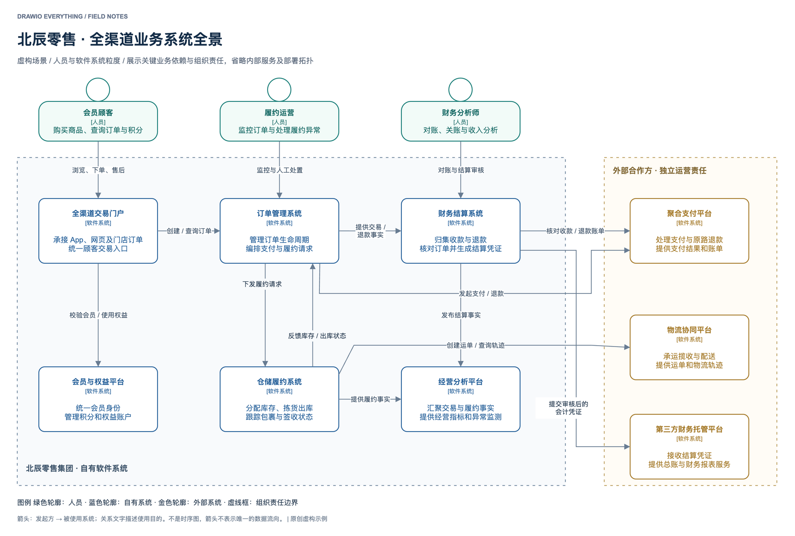

好的工程图，应该让读者迅速看清重点、层级和关系。`drawio-everything` 将基础绘图规范、图种语义和从优秀图例提炼的表达方法结合起来，帮助 AI 生成可编辑的 `.drawio` 图，并通过实际渲染检查效果。

它的核心是持续学习：你提供照片、截图、原生文件或总结，skill 分别记录**风格、结构模板、局部模式**，再根据新内容选择和适配。每次学习都有来源和适用边界；个人偏好与技术验证分别记录。

## 快速开始

将本仓库作为 `drawio-everything` 技能目录放入 Codex 的 skills 目录。首次安装、目标目录不存在时：

```bash
git clone --branch codex/publish-skill-gallery \
  https://github.com/Junglepan/drawio-everything.git \
  "${CODEX_HOME:-$HOME/.codex}/skills/drawio-everything"
```

已有同名 skill 时，先对比版本再更新，避免覆盖本地修改。其他支持 `SKILL.md` 的助手可按其技能加载机制使用；目前未逐一验证所有客户端。

生成 XML 需要具备文件读写能力的 AI 助手；预览可使用 draw.io Desktop 或 diagrams.net 编辑器。使用此仓库的示例重建脚本需要 Python 3。skill 不包含模型、draw.io 安装包或专用 MCP 服务。

**画一张新图**

```text
使用 $drawio-everything，为订单平台画系统上下文图。
读者是产品与研发负责人；包含客户、订单平台、支付平台、配送平台。
关系为客户下单、订单平台发起支付和提交配送任务。
交付可编辑 .drawio 与 PNG，检查文字和连线。
```

**从参考图学习**

```text
使用 $drawio-everything，学习附件图例。
我喜欢它的分组和阅读顺序。提取可复用风格与结构模板，
记录适用场景、内容增多时的处理方法及不适合照搬的部分。
```

**明确偏好范围**

```text
这次只把异常路径改成橙色，不修改默认风格。
```

```text
以后我的应用资产图默认使用这种卡片布局，其他图种保持不变。
```

## 示例画廊

## 进阶场景：接近真实工作的图

四个独立的虚构场景展示更高的信息密度。分别采用系统边界、协作泳道、字段路径与循环控制的表达方式；不把所有图种套进同一种卡片布局。点击预览可查看大图，源文件可直接在 draw.io 编辑。

### 全渠道零售 · 系统全景

面向架构评审：人员与系统保持同一层级，组织边界区分内部能力和外部合作方；每条关系说明业务目的，节点给出类型与职责。


[可编辑源文件](examples/advanced/retail-landscape.drawio) · [完整预览](examples/advanced/retail-landscape.png)

### 跨组织退货 · 协作流程

面向流程评审：区分客户与企业参与者、企业内部岗位交接以及条件分支。采用 BPMN 表示法子集，按声明范围检查，不声称完整规范认证。

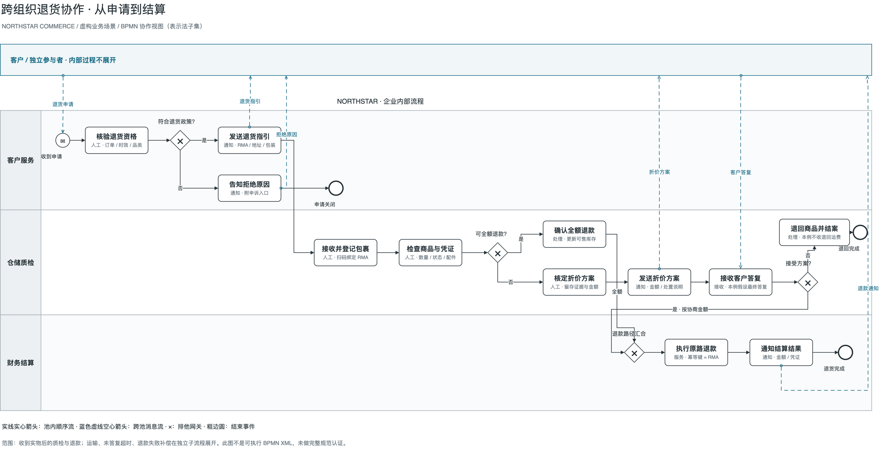

[可编辑源文件](examples/advanced/returns-collaboration.drawio) · [完整预览](examples/advanced/returns-collaboration.png)

### 收入指标 · 字段级血缘

面向数据治理：展开相关字段，说明转换与指标口径；突出选定影响路径，同时保留来源和下游消费者。静态图中不放置无法操作的筛选或翻页控件。

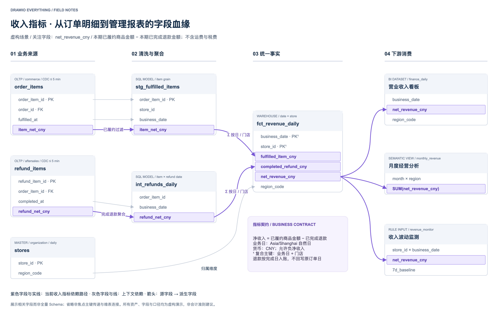

[可编辑源文件](examples/advanced/revenue-lineage.drawio) · [完整预览](examples/advanced/revenue-lineage.png)

### 批量对账 · 循环与异常收敛

面向实现评审：主流程之外交代重试上限、循环推进、失败处理与取消出口，避免只有成功路径的演示流程。

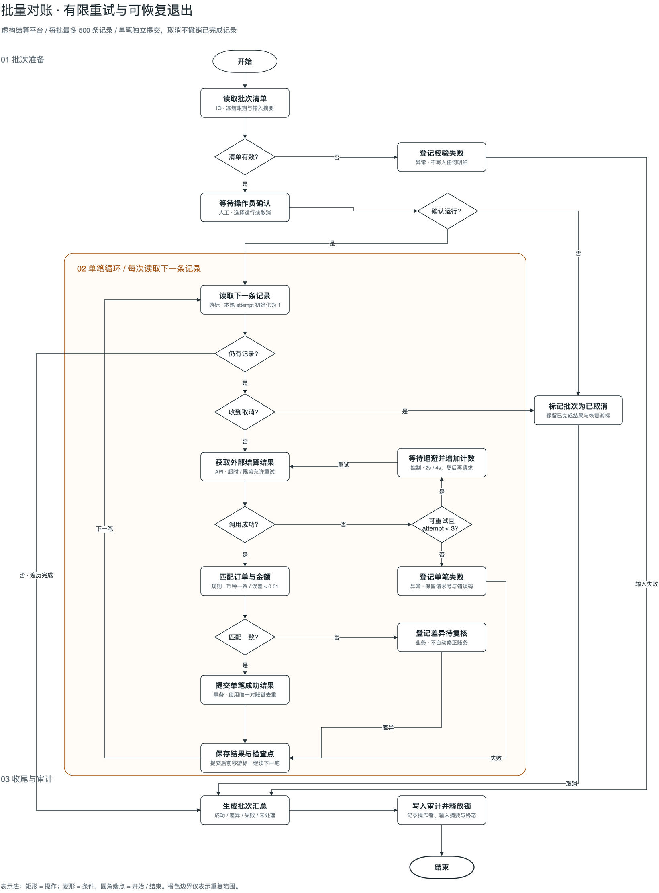

[可编辑源文件](examples/advanced/reconciliation-flow.drawio) · [完整预览](examples/advanced/reconciliation-flow.png)

[专业图质量准则](references/professional-diagrams.md) · [按场景选择示例](references/gallery.md)

## 基础示例：11 类结构起点

以下 11 张图由本项目使用虚构内容制作，提供原生节点、文字与连接器，可在 draw.io 中编辑。PNG 由 draw.io Desktop 实际导出；示例用于展示结构与表达方式，不构成生产架构方案或全面标准合规认证。

| 类型 | 适用场景 | 设计重点 |
| --- | --- | --- |
| [流程图](examples/01-flow.drawio) | 操作流程、条件分流 | 主方向、条件标签与分支汇合 |
| [泳道图](examples/02-swimlane.drawio) | 审批与跨团队交接 | 责任分区与阶段对齐；非完整 BPMN 范例 |
| [部署架构图](examples/03-cloud.drawio) | 部署方案与技术沟通 | 网络边界、服务分区与重复实例 |
| [集群组件图](examples/04-cluster.drawio) | 组件职责与控制关系 | 控制面、工作节点与同构布局 |
| [时序图](examples/05-sequence.drawio) | 接口调用与异步通知 | 参与者列、阶段与消息方向 |
| [系统上下文图](examples/06-context.drawio) | 系统范围与外部协作 | 同一抽象层级与关系说明 |
| [应用资产图](examples/07-application.drawio) | 应用盘点与生命周期 | 位置表达归属，颜色与符号表达状态 |
| [数据血缘图](examples/08-lineage.drawio) | 字段影响分析 | 局部展开与关注路径 |
| [网络拓扑图](examples/09-network.drawio) | 设备连接与运维总览 | 区域、接入与共享骨干 |
| [业务能力图](examples/10-capability.drawio) | 能力目录与企业规划 | 层级网格与独立说明区 |
| [数据流水线图](examples/11-pipeline.drawio) | 采集、处理与消费 | 输入、处理、输出三段式 |

### 流程图

主方向、条件标签与分支汇合。适用于操作流程、条件分流。

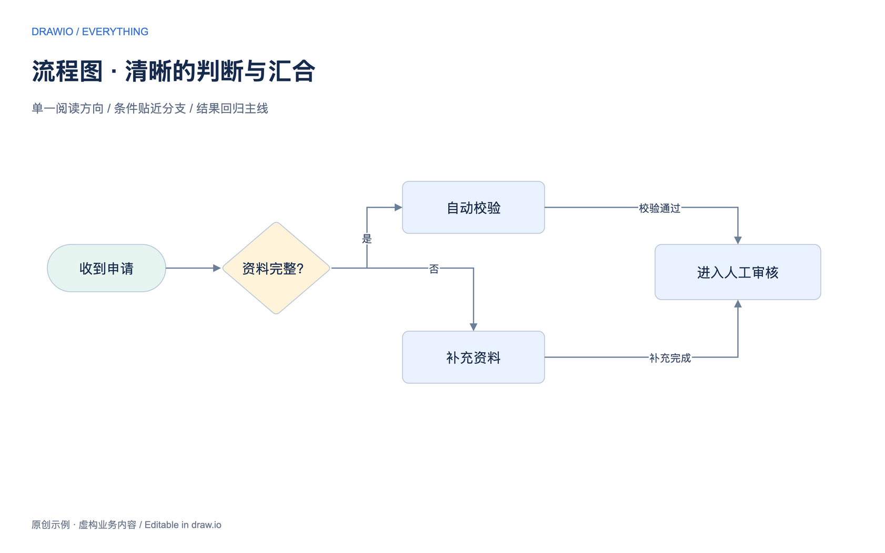

[可编辑源文件](examples/01-flow.drawio) · [完整预览](examples/01-flow.png)

### 泳道图

责任分区与阶段对齐；非完整 BPMN 范例。适用于审批与跨团队交接。

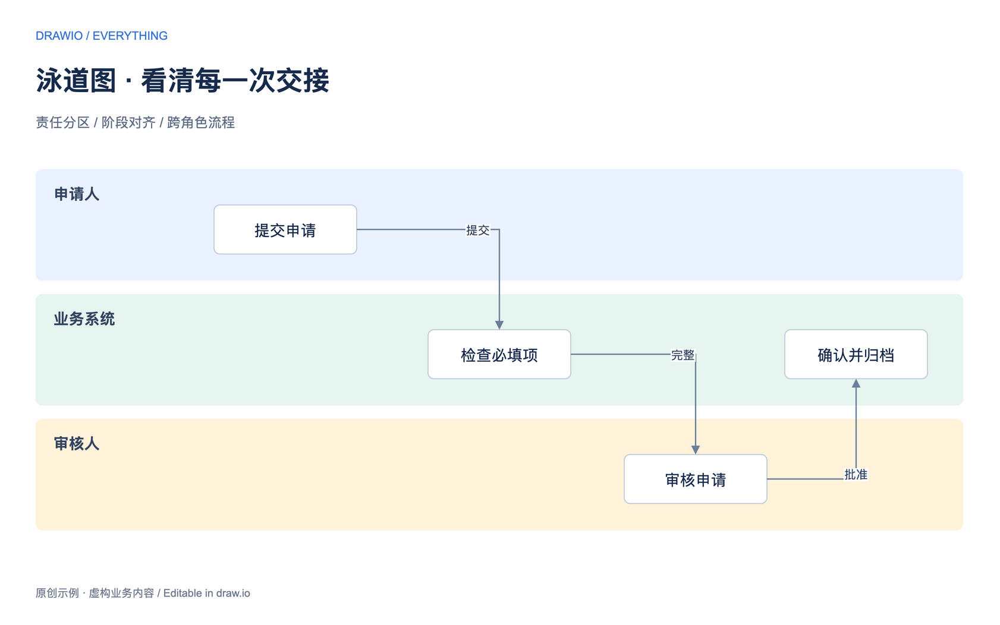

[可编辑源文件](examples/02-swimlane.drawio) · [完整预览](examples/02-swimlane.png)

### 部署架构图

网络边界、服务分区与重复实例。适用于部署方案与技术沟通。

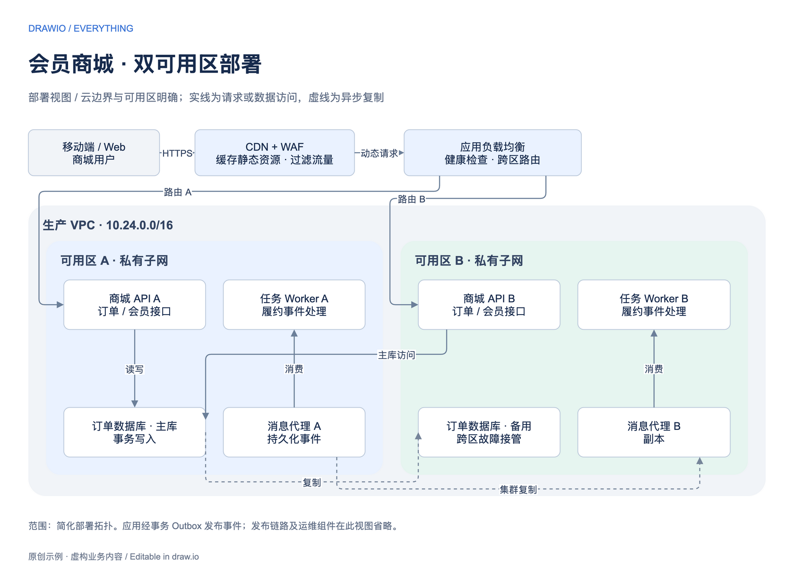

[可编辑源文件](examples/03-cloud.drawio) · [完整预览](examples/03-cloud.png)

### 集群组件图

控制面、工作节点与同构布局。适用于组件职责与控制关系。

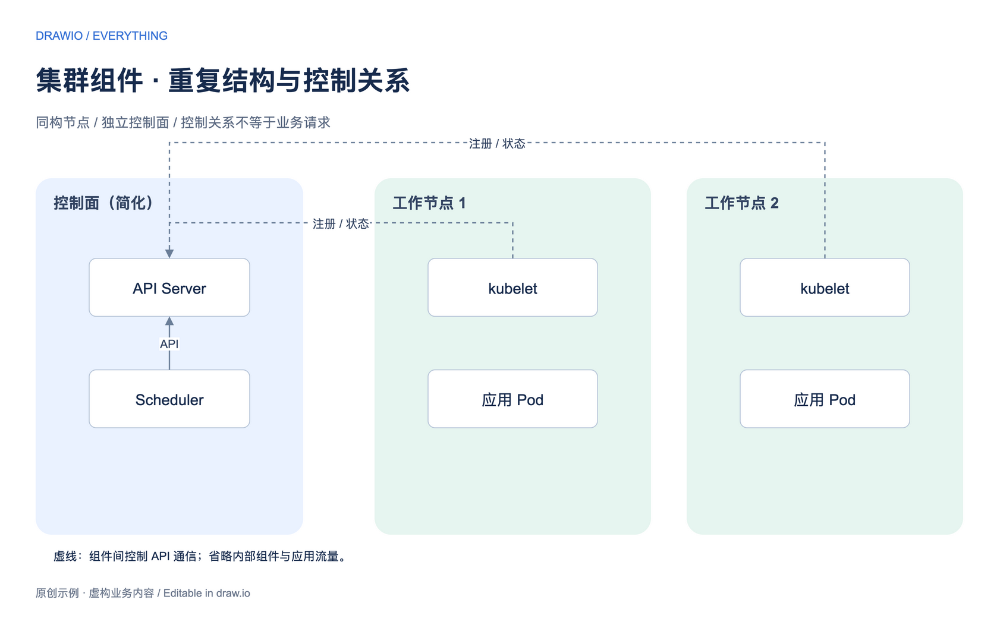

[可编辑源文件](examples/04-cluster.drawio) · [完整预览](examples/04-cluster.png)

### 时序图

参与者列、阶段与消息方向。适用于接口调用与异步通知。

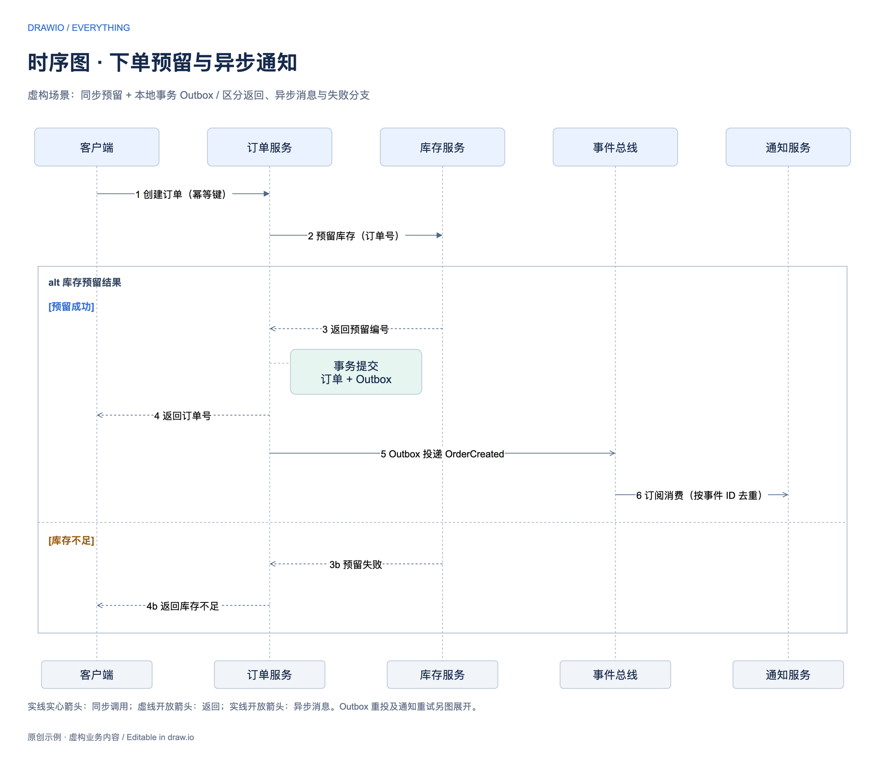

[可编辑源文件](examples/05-sequence.drawio) · [完整预览](examples/05-sequence.png)

### 系统上下文图

同一抽象层级与关系说明。适用于系统范围与外部协作。


[可编辑源文件](examples/06-context.drawio) · [完整预览](examples/06-context.png)

### 应用资产图

位置表达归属，颜色与符号表达状态。适用于应用盘点与生命周期。

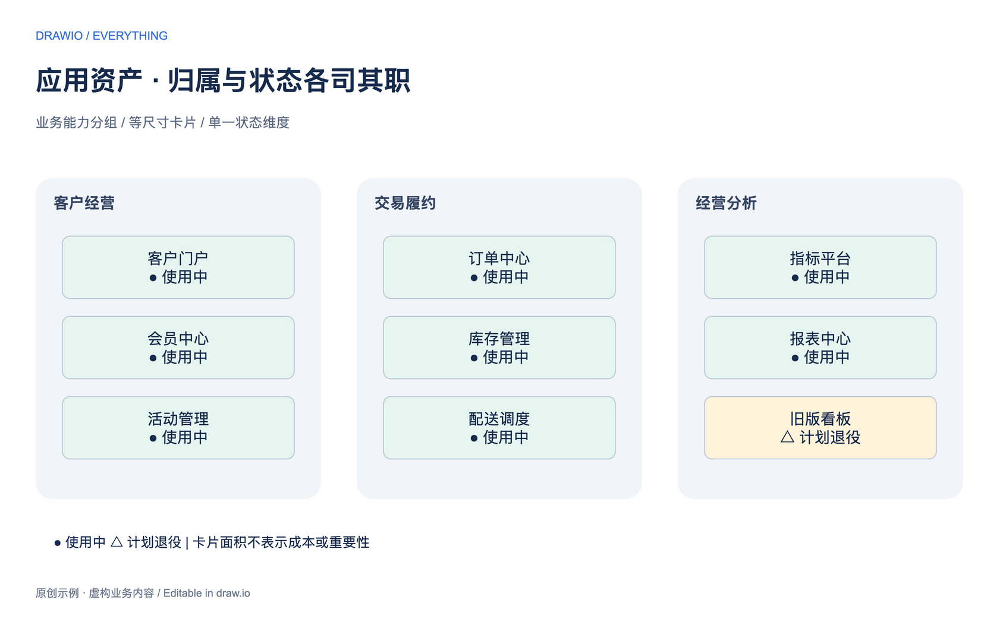

[可编辑源文件](examples/07-application.drawio) · [完整预览](examples/07-application.png)

### 数据血缘图

局部展开与关注路径。适用于字段影响分析。

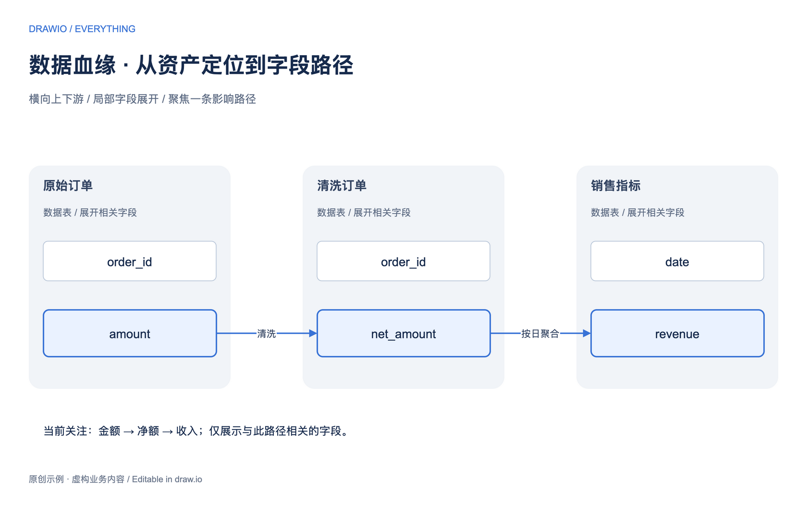

[可编辑源文件](examples/08-lineage.drawio) · [完整预览](examples/08-lineage.png)

### 网络拓扑图

区域、接入与共享骨干。适用于设备连接与运维总览。

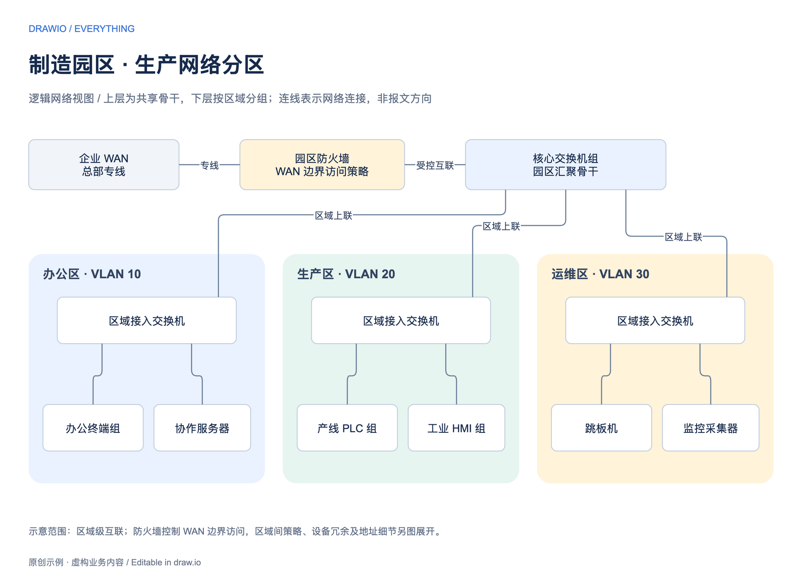

[可编辑源文件](examples/09-network.drawio) · [完整预览](examples/09-network.png)

### 业务能力图

层级网格与独立说明区。适用于能力目录与企业规划。

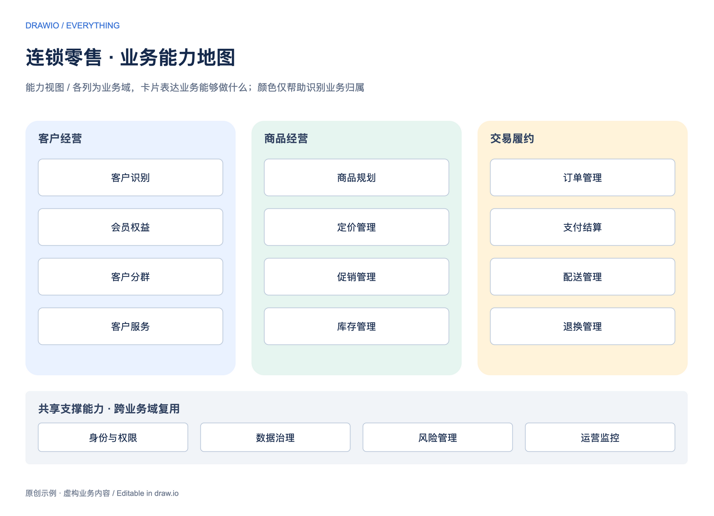

[可编辑源文件](examples/10-capability.drawio) · [完整预览](examples/10-capability.png)

### 数据流水线图

输入、处理、输出三段式。适用于采集、处理与消费。

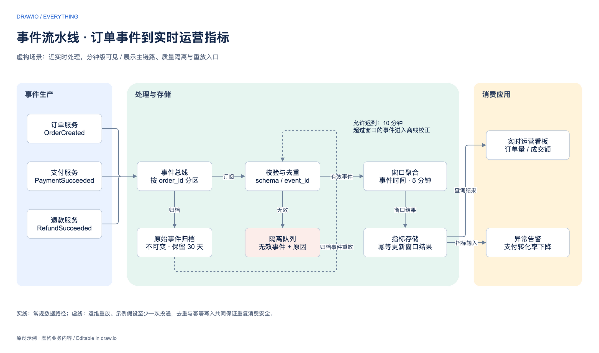

[可编辑源文件](examples/11-pipeline.drawio) · [完整预览](examples/11-pipeline.png)

## 如何学习你的风格

```text
参考图 / 照片 / 原生文件 / 总结
                ↓
观察：阅读顺序、分组、层级、线条、留白
                ↓
提炼：风格 + 结构模板 + 局部模式
                ↓
保存候选：来源、适用条件、版本、偏好
                ↓
新内容迁移 → 原生结构检查 → 实际渲染 → 修正
```

| 资产 | 学习什么 | 例子 |
| --- | --- | --- |
| 风格 | 配色关系、文字层级、线条、圆角和图标语言 | 黑白细线时序、浅色分区卡片 |
| 模板 | 固定区域、变量槽位、阅读顺序和扩展规则 | 主流程与挂接子系统、分阶段时序 |
| 局部模式 | 可以组合使用的表达方法 | 共享侧栏、诊断注释、主次文字卡片 |

个人知识库默认保存于 `~/.drawio-everything/library/`，与 skill 文件分离。仓库包含公开示例与方法；个人照片、业务资料和本地学习记录不会随安装附带，也不会自动上传。

候选记录不等于默认风格。只有明确要求才改变长期默认；只有完成新内容迁移、原生文件与渲染检查，才能将对应资产标记为已验证。拍照图的颜色和尺寸通常只做视觉估计，不伪装成精确测量。

## 项目结构

```text
SKILL.md                 技能入口与核心约定
agents/openai.yaml       Codex 展示元数据
references/              学习、选型、绘图与资产存储规则
examples/                11 类基础示例 + advanced/ 下 4 个进阶场景
scripts/                 源文件生成与结构检查脚本
```

[图种选择](references/selection.md) · [图例学习](references/learning.md) · [资产约定](references/library.md) · [绘图与验证](references/drawing.md) · [画廊适配说明](references/gallery.md)

## 重建示例

```bash
python3 scripts/build_gallery.py
python3 scripts/build_advanced_architecture.py
python3 scripts/build_advanced_process.py

# macOS，已安装 draw.io Desktop；其他系统改为对应可执行文件路径
for diagram in examples/*.drawio examples/advanced/*.drawio; do
  /Applications/draw.io.app/Contents/MacOS/draw.io \
    -x -f png -s 1.5 -o "${diagram%.drawio}.png" "$diagram"
done

python3 scripts/check_gallery.py
```

生成脚本使用标准库，负责重建本仓库固定示例，不是通用自动排版引擎。修改布局后应重新导出并检查所有受影响的图。

## 能力边界

- 支持基于上下文选择、适配与编辑图示，输出质量依赖实际内容、模型和可用工具。
- 基础泳道图不自动等于 BPMN 合规；系统全景也不自动等于 C4 的某个层级。
- 箭头、虚实线、边界优先表达正确语义，不能仅因美观而替换。
- PNG 只是预览，`.drawio` 才是可编辑交付；无法渲染时必须说明未完成视觉验证。
- 本仓库不提供全面标准审计器、自动学习服务或后台同步服务。

## 参考与贡献

工程执行思路参考了 [Agents365-ai/drawio-skill](https://github.com/Agents365-ai/drawio-skill)，未复制其代码。原生文件与导出参见 [draw.io 文档](https://www.drawio.com/doc/)，C4 表示法参见 [C4 notation](https://c4model.com/diagrams/notation)。仓库画廊为重新制作的示意图，不使用第三方截图作为效果展示。

欢迎提交图例或改进建议，并说明：希望解决的问题、喜欢的设计点、使用场景和允许公开的范围。业务素材请先脱敏；避免提交个人知识库、凭证或无权再分发的图片。
